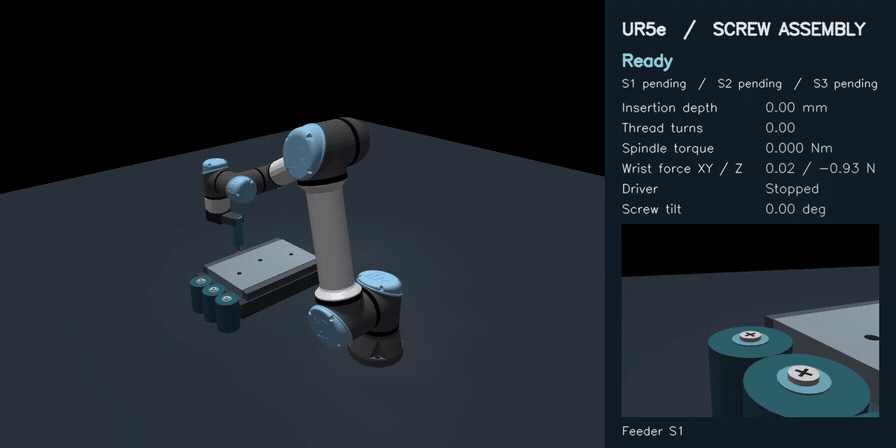

# UR5e 三螺丝自动装配与质检

在 MuJoCo 中按一次 **Enter**，UR5e 从三个空孔开始，定位工件、逐颗取料和旋紧，最后用腕部相机检查三处并保存照片。电批遇到斜咬牙会停转、退牙、扶正重试，复试仍卡滞或滑牙时，整件转为**待复检**。

**Windows · Python 3.12 · MuJoCo · OpenCV CPU**

## 演示

| 视觉找孔与斜咬牙恢复 | 持续滑牙与待复检 |
| :---: | :---: |
|  |  |
| S2 退牙扶正后重试成功，三颗全部通过质检。<br>[原速录像](docs/media/vision-and-cross-thread.mp4) | S2 复试仍空转，整件待复检，S3 暂停装配。<br>[原速录像](docs/media/stripped-thread-review.mp4) · [判定曲线](docs/fastening-signature.png) |

## 快速开始

在 Windows PowerShell 中执行。仓库访问需要有权限的 GitHub 账号。

```powershell
git clone https://github.com/Ap1us0/ur5e-screw-assembly-qc.git
Set-Location ur5e-screw-assembly-qc
py -3.12 -m venv .venv
$py = '.\.venv\Scripts\python.exe'
& $py -m pip install -r requirements-win-py312.lock
& $py -m inspection assemble --alignment vision --seed 106 --viewer --video
```

在 MuJoCo 窗口按 **Enter** 启动，再按一次可复位重跑。完成后按 **O** 打开本轮报告。照片、MP4、曲线和 JSON 保存在 `outputs/assembly/<轮次>`。视觉检测使用 CPU，三维窗口与录制使用 OpenGL。

## 三个可复现工况

以下命令沿用上面的 `$py`。

| 工况 | 可以观察到的结果 |
| --- | --- |
| 视觉定位与斜咬牙 | 夹具偏移 −8 mm、+4 mm、−4°。腕部相机定位三个空孔，S2 斜咬牙后停转、退牙并扶正，同一颗螺丝重试成功 |
| 持续滑牙 | S2 连续旋转却进给不足。第二次仍异常，整件待复检。S1 已装配，S3 暂停 |
| 缺件巡检 | 跳过装配，S2 主视角反光，换角度确认缺件并保存照片 |

```powershell
# 视觉定位 + 斜咬牙恢复
& $py -m inspection assemble --alignment vision --fixture-shift -8 4 -4 --fault cross_thread --fault-site S2 --seed 106 --viewer --video

# 滑牙 + 待复检
& $py -m inspection assemble --fault stripped_thread --fault-site S2 --seed 106 --viewer --video

# 缺件 + 反光补拍
& $py -m inspection run --missing S2 --fault glare --fault-site S2 --viewer --video
```

## 判定逻辑

- **找孔。** 腕部相机根据三个空孔估计夹具的 XY 偏移和偏航角，更新装配和质检目标。图像反光或无法确认孔缘时补拍，两个角度都不可判则在取件前停止。
- **旋紧。** 电批利用孔口侧向力微调 XY。扭矩升高且进给停滞时停转退牙。扭矩低、转角持续增加而深度跟不上螺距时，记录滑牙特征。退牙后重新找正，同一颗螺丝最多重试一次。
- **放行。** 三颗都通过入座与撤刀留置检查，才启动统一质检。独立巡检输出合格、缺件或待复检。持续机械异常保留待复检判定及停机证据。

斜咬牙工况使用固定螺纹牙侧接触复现卡滞。牙侧压溃采用固定受损几何，滑牙采用降阶螺距传递模型。计算假定相机和工具的仿真标定已知。详见[仿真模型、故障参数及报告格式](docs/simulation.md)。

## 仿真验收结果

| 检查 | 结果 | 复现入口 |
| --- | --- | --- |
| 原装配闭环 | **20/20**，零误放行 | `assembly-acceptance` · [CSV](docs/evidence/assembly-acceptance.csv) |
| 完好与缺件巡检 | **20/20**，零误放行 | `simulate-acceptance` · [CSV](docs/evidence/inspection-acceptance.csv) |
| 夹具偏移和视觉补拍 | **15/15** 符合预期。12 组偏移全部完成装配，3 组双视角遮挡均在取件前停止 | `alignment-study` · [CSV](docs/evidence/alignment-study.csv) |
| 力反馈找正与卡滞 | **22/22** 符合预期，零误放行 | `force-study` · [CSV](docs/evidence/force-study.csv) |
| 固定螺纹内的斜咬牙 | **15/15** 符合预期。4 组斜咬牙扶正后均恢复 | `thread-study` · [CSV](docs/evidence/thread-study.csv) |
| 牙损、滑牙与复检 | **12/12** 符合预期，7 轮坏牙全部待复检 | `thread-health-study` · [CSV](docs/evidence/thread-health-study.csv) |

```powershell
& $py -m inspection verify-samples
& $py -m inspection assembly-acceptance --jobs 3
& $py -m inspection thread-health-study --jobs 3
& $py -m unittest discover -s tests -v
```

CSV 保留逐轮场景、种子、判定和关键读数。运行对应子命令可生成完整 HTML 报告和当轮原图。基准与优化运动在相同的 10 组合格工况中比较，仿真整轮中位数从 **48.21 s 降到 28.56 s**。[节拍对比图](docs/cycle-comparison.png)

## 交付范围

当前结项范围为**一种工件、固定夹具、三个螺丝位的 MuJoCo 仿真验证**。仓库附带真实 UR5e 巡检的配置、URScript 生成工具与 USB 相机接口。相机、电批和工装的实机标定、设备联调与实物验收待现场完成。实机验收条件为 **20 轮至少 18 轮判对，缺件零误放行**。[实机接入与验收](docs/hardware.md)

UR5e 模型源自 [MuJoCo Menagerie](https://github.com/google-deepmind/mujoco_menagerie/tree/eea4c7431b63da8278b0ff31638e0b0e941cec0e/universal_robots_ur5e)，模型许可见 [models/LICENSE-UR5e](models/LICENSE-UR5e)。初版结项 PDF 和交付包见 [v1.0.0 历史归档](https://github.com/Ap1us0/ur5e-screw-assembly-qc/releases/tag/v1.0.0)。
