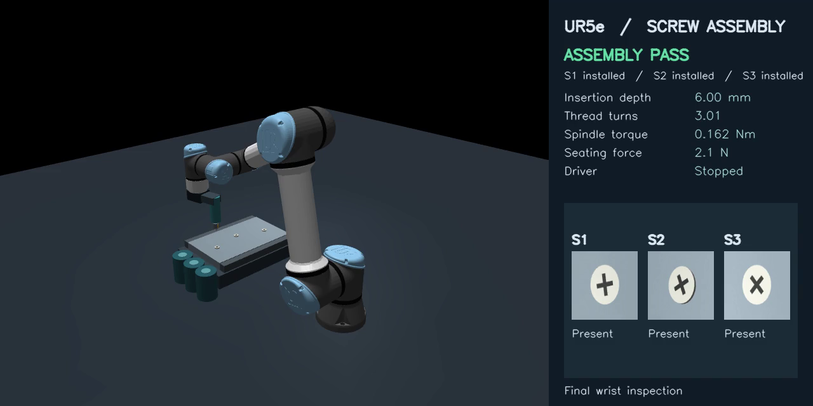

# UR5e 三螺丝装配与质检

[结项交付包](https://github.com/Ap1us0/ur5e-screw-assembly-qc/releases/download/v1.0.0/ur5e-screw-assembly-qc-v1.0.0.zip) · [结项报告 PDF](https://github.com/Ap1us0/ur5e-screw-assembly-qc/releases/download/v1.0.0/closeout-report.pdf) · [演示录像](https://github.com/Ap1us0/ur5e-screw-assembly-qc/releases/download/v1.0.0/assembly-demo.mp4)



结项批次中，装配与质检闭环和纯视觉仿真各 20/20 轮判对，均为零误放行。干净的 Windows Python 3.12 环境回归测试通过。详细工况、原始照片和逐轮记录可在结项交付包中查看。

## 首次运行

```powershell
py -3.12 -m venv .venv
.\.venv\Scripts\python.exe -m pip install -r requirements-win-py312.lock
.\.venv\Scripts\python.exe -m inspection assemble --viewer --video --seed 106 --image-fault glare
```

在 Viewer 中按 **Enter** 启动完整流程，按 **O** 查看本轮报告。


Windows 版操作台。对固定夹具上的一种工件，按 S1、S2、S3 顺序拍照。每个螺丝位有主视角和补拍视角。主图反光、模糊、欠曝、无法取图或匹配不确定时，机械臂到补拍位重拍一次。OpenCV 在 CPU 上检查图像质量并比对有件、缺件两组模板。

## 三颗螺丝自动装配

S1、S2、S3 初始为空，三个固定供料座各放一颗螺丝。UR5e 按 S1 → S2 → S3 的顺序逐颗取件、对孔、入牙和旋紧。程序根据深度、螺距一致性、入座接触力、低角速度和扭矩联合停转。每次撤刀后检查螺丝是否留在孔内。三颗全部留置后，腕部相机才开始统一复检三处，并在结束后再次检查三颗的留置状态。

```powershell
$inspectionPython = '.\.venv\Scripts\python.exe'
& $inspectionPython -m inspection assemble --viewer --video
```

在 MuJoCo Viewer 中按一次 **Enter** 开始，可看三个孔位进度、供料和孔位特写、旋入深度与电批扭矩。完成后按 **O** 查看录像、逐孔曲线、CSV 和三点照片，再按 **Enter** 可复位另存一轮。`--site S2` 可单独演示一个位置，其余位置预装。`--fault misaligned`、`--fault blocked`、`--fault empty_feeder` 分别验证对孔超差、孔口受阻、供料位没有螺丝。三处模式默认在 S2 注入故障，也可用 `--fault-site` 指定位置。装配中断时电批制动，保留已完成的螺丝和记录，跳过后续未装配位置及最终质检。退出码 1 表示装配中止、待复检或异常。输出在 `outputs/assembly/<轮次>`。

装配使用带轴向弹簧的电批、三颗独立自由体螺丝和固定夹具。取件前批头回到可对准的角度，再根据接触启用磁吸等效约束。对孔参考固定夹具坐标，门控使用仿真中的螺丝位姿反馈。各螺丝在各自的螺纹约束下保持留置，电批每次只连接当前螺丝。旋入阶段使用 MuJoCo 的标量关节等式约束表达 2.0 mm 螺距，模型用实际入座接触产生的法向力估算头部摩擦阻力。装配运动、螺丝转动和深度都由动力学积分产生。螺纹牙面和磁力场采用等效模型，0.14 N·m 扭矩门限、6 mm 深度目标和 0.65 mm 入牙对孔门限是该仿真工况设定。实机装配仍需实际电批、供料件、螺纹规格与扭矩标定。[MuJoCo 等式约束参考](https://mujoco.readthedocs.io/en/stable/XMLreference.html#equality-joint)

## 结项复现与验收

在其他 Windows 电脑可用 Python 3.12 建立项目自己的环境，启动和验收流程相同。`requirements.txt` 锁定直接依赖。

```powershell
py -3.12 -m venv .venv
.\.venv\Scripts\python.exe -m pip install -r requirements.txt
$inspectionPython = '.\.venv\Scripts\python.exe'
& $inspectionPython -m inspection assemble --viewer --video --seed 106 --image-fault glare --image-site S2
& $inspectionPython -m inspection assembly-acceptance --jobs 3
& $inspectionPython -m inspection simulate-acceptance
& $inspectionPython -m inspection verify-samples
& $inspectionPython -m unittest discover -s tests -v
```

`assembly-acceptance` 运行固定的 20 轮装配与质检闭环工况，验收门槛为至少 18 轮判定正确且证据齐全，并且零误放行。10 轮预期合格，2 轮预期待复检，8 轮预期装配中止。输出在 `outputs/assembly-acceptance/<批次>`，包括预期清单、实际统计、逐轮照片、装配事件、旋入曲线和电批停转记录。工况覆盖供料偏移、对孔偏差、入座摩擦扰动、单视角反光或模糊、双视角不可判、空供料位和孔口障碍。非零 `--seed` 对每个位置复现 XY 偏移、摩擦和成像扰动。`--image-fault` 与 `--image-site` 仅作用于装配后的统一质检。仿真验证范围见结项报告，实物标定与 20 轮实机验收各自留档。

## MuJoCo 纯视觉巡检演示

使用上述 Python 3.12 环境，从项目目录运行以下命令。

```powershell
$inspectionPython = '.\.venv\Scripts\python.exe'
& $inspectionPython -m inspection run --viewer --video --missing S2 --fault glare --fault-site S2
```

在 Viewer 中按一次 **Enter** 启动。画面同时显示真实积分得到的关节运动、相机实测轨迹、当前观察线、三个螺丝位状态和腕部照片。本例先在 S2 主视角检测到反光，再移动到倾斜补拍位确认缺螺丝，最后返回待机位。完成后按 **O** 打开报告，再按 **Enter** 可用同一工况另存一轮。`--video` 将本轮 3D 运动和腕部照片录成 MP4，省略 `--viewer` 可直接录制。两者都省略时只做无窗口检测。`--missing` 可指定多个位置，例如 `'S1,S3'`。`--fault` 也支持 `blur` 和 `both_bad`。

沿用既有轨迹规划中将运动学候选解和实际积分状态分开的做法。六个腕部拍摄目标各自在独立 `MjData` 中用 Jacobian 逆运动学求解。运行中写入 `data.ctrl`，由 `mj_step` 更新 UR5e 关节状态。`trajectory.csv` 写出六关节实测弧度、相机实测 XYZ、目标 XYZ、终点位姿差和每次实际取图时刻。PNG 原图与 HTML、JSON 结果保存在 `outputs/runs/<轮次>`。检测走 CPU，仿真渲染使用 Windows OpenGL。

| 整件结果 | 判定条件 |
| --- | --- |
| 合格 | 三处均有螺丝，且完成返回待机位及设备收尾 |
| 缺件 | 至少一处照片确认缺螺丝 |
| 待复检 | 其余情况，例如两次图像都不可判或工站中断 |

在项目目录也可用 PowerShell 运行。

```powershell
& $inspectionPython -m inspection verify-samples
& $inspectionPython -m inspection run --missing S2 --fault glare --fault-site S2
& $inspectionPython -m inspection simulate-acceptance
& $inspectionPython -m unittest discover -s tests -v
```

随项目提供三处、两视角的参考样图，以及另一组带光照、位置和噪声扰动的仿真验证图。离线验证覆盖 6 张有件、6 张缺件和 2 张坏图。20 轮仿真包含 10 轮完好、10 轮缺件，并在 10 轮加入单视角的反光或模糊。`outputs/simulation-acceptance/<批次>` 包含验收统计、真值清单和各轮原图。

## 接入真实 UR5e 与相机

实机驱动使用 PolyScope 5 的 URScript 和 Windows USB UVC 相机。PC 发出拍摄位编号，控制器执行示教路径并确认到位和停止后，PC 取新帧。实机使用示教轨迹和实物照片，仿真的关节位及模板不参与实机运行。当前程序已测试 PC 端协议，URScript 仍需在目标控制器验证。

1. 复制 `station/example.json` 为 `station/local.json`。填入 Windows 网卡和 UR5e 的地址、相机编号和实际图像分辨率。`home` 是控制器读出的六关节弧度值。`routes` 的每个视角是从公共待机位出发的一组关节点，最后一个是拍摄位，前面可加过渡点。每次换拍摄位先沿原路线退回待机位，再走目标路线。现场先确认工具和负载参数，低速逐段验证六条去回路径与夹具间隙。
2. 从配置生成 `station/local.script`。在 PolyScope 5 程序中添加 Script 节点，选 File 并加载脚本。把机械臂置于示教待机位，现场启动该程序。站点程序在待机位等待 Windows 开始一轮，结束后返回待机位等待下一轮。若通信中断，站点程序停止派发新动作。恢复时按现场操作流程确认当前姿态，回到示教待机位再启动。控制器使用进站握手验证当前示教配置的指纹。修改轨迹后重新生成脚本并更新控制器上的版本。[PolyScope Script 节点](https://www.universal-robots.com/manuals/EN/HTML/SW5_26/Content/prod-usr-man/software/PolyScope/content/AdvProgNodes/commandtab_script_en.htm) · [URScript TCP/IP 接口](https://docs.universal-robots.com/tutorials/communication-protocol-tutorials/tcp-ip-client.html)
3. 用 `collect` 保存实物样图。每张照片需来自对应螺丝位、视角和最终相机分辨率。准备完好和缺件样件，标签由操作者按实际缺件位填写。复制 `station/profile.example.json` 为 `station/profile.local.json`，将参考 PNG 放进 `station/references/`，按相同的 `site` 和 `angle` 填入 `present`、`missing` 的文件路径。每组允许多张图，路径相对于配置文件。将来自其他工件或其他轮次的图片留作独立验证。
4. 校准六个视角的 `roi`，格式为 `[左, 上, 宽, 高]`，单位为像素。ROI 要覆盖螺丝头和孔缘。`shift_px` 是允许的微小位置偏移。用独立实物样图检验 `min_sharpness`（拉普拉斯方差）、`max_glare` 与 `max_dark`（极亮、极暗区域占比），以及 `min_score` 和 `min_margin`（最小匹配分、两类分差）。`samples.csv` 的列为 `site,angle,expected,image`，`expected` 填 `present`、`missing` 或 `review`。反光、模糊、遮挡和位置偏移的实物样图有助于验证待复检门限。
5. 离线验证通过后，用实机配置打开操作台。装夹工件后，每点一次 **开始质检**，执行并保存一轮。

```powershell
& $inspectionPython -m inspection build-station --station station/local.json --output station/local.script
& $inspectionPython -m inspection collect --station station/local.json '--missing='
& $inspectionPython -m inspection collect --station station/local.json --missing 'S1,S2,S3'
& $inspectionPython -m inspection verify-samples --profile station/profile.local.json --manifest real_holdout/samples.csv --output outputs/hardware-samples.json
& $inspectionPython -m inspection gui --station station/local.json --profile station/profile.local.json
```

## 实机 20 轮验收

用完好件和缺件分别跑若干轮，共 20 轮。每轮由操作者先独立记录实际缺件位置，建议 10 轮完好、10 轮缺件，并覆盖 S1、S2、S3。把每轮的 `report.json` 路径填入 CSV，每个报告只填一次。`missing` 留空表示完好，多处缺件用 `|` 分隔。示例两行用于说明格式，正式清单须包含 20 轮。

```csv
missing,report
,outputs/runs/<完好轮次编号>/report.json
S1|S3,outputs/runs/<缺件轮次编号>/report.json
```

```powershell
& $inspectionPython -m inspection evaluate --manifest trials.csv --source hardware --output outputs/hardware-acceptance.json
```

验收程序要求整件命中至少 18/20 且缺件判为合格次数为 0。待复检计入未判对。统计也记录各螺丝位判对数量，实机验收只收实机来源的报告。当前验证数据均来自 MuJoCo，实物样图标定和实机统计尚待现场执行。

## 模型来源

`models/inspection.xml` 基于 MuJoCo Menagerie 的 UR5e MJCF，固定在提交 `eea4c7431b63da8278b0ff31638e0b0e941cec0e`。保留了机器人模型与网格，增加夹具、工件、腕部相机和仿真灯光。网格在 `models/ur5e-meshes.zip`，运行时直接读取。许可证见 `models/LICENSE-UR5e`。[MuJoCo Menagerie UR5e](https://github.com/google-deepmind/mujoco_menagerie/tree/eea4c7431b63da8278b0ff31638e0b0e941cec0e/universal_robots_ur5e) · [MuJoCo Python 文档](https://mujoco.readthedocs.io/en/stable/python.html)
