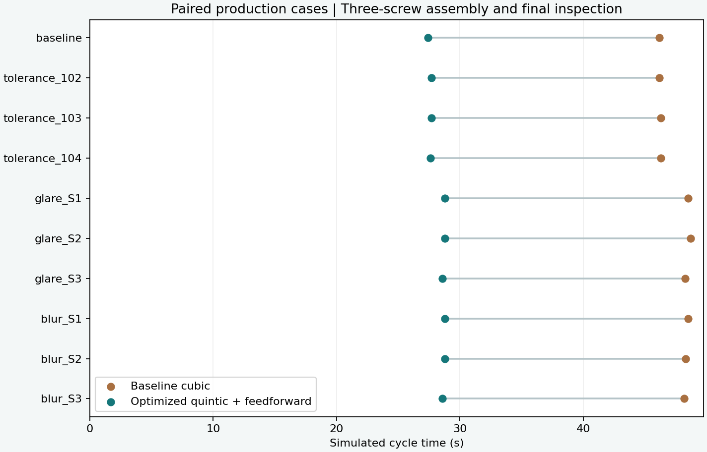

# 仿真模型与工况复现

先按 [README](../README.md) 安装 Windows Python 3.12 环境。此页说明仿真模型、故障注入和验收证据。命令均从仓库根目录运行。

```powershell
$inspectionPython = '.\.venv\Scripts\python.exe'
```

## 三颗螺丝自动装配

S1、S2、S3 初始为空，三个固定供料座各放一颗螺丝。UR5e 按 S1 → S2 → S3 的顺序逐颗取件、对孔、入牙和旋紧。程序根据深度、螺距一致性、入座接触力、低角速度和扭矩联合停转。每次撤刀后检查螺丝是否留在孔内。三颗全部留置后，腕部相机才开始统一复检三处，并在结束后再次检查三颗的留置状态。

```powershell
$inspectionPython = '.\.venv\Scripts\python.exe'
& $inspectionPython -m inspection assemble --viewer --video
```

在 MuJoCo Viewer 中按一次 **Enter** 开始，可看三个孔位进度、供料和孔位特写、旋入深度与电批扭矩。完成后按 **O** 查看录像、逐孔曲线、CSV 和三点照片，再按 **Enter** 可复位另存一轮。`--site S2` 可单独演示一个位置，其余位置预装。`--fault misaligned`、`--fault blocked`、`--fault empty_feeder` 分别验证对孔超差、孔口受阻、供料位没有螺丝。三处模式默认在 S2 注入故障，也可用 `--fault-site` 指定位置。装配中断时电批制动，保留已完成的螺丝和记录，跳过后续未装配位置及最终质检。退出码 1 表示装配中止、待复检或异常。输出在 `outputs/assembly/<轮次>`。

装配使用带轴向弹簧的电批、三颗独立自由体螺丝和固定夹具。取件前批头回到可对准的角度，再根据接触启用磁吸等效约束。初始对孔使用固定示教或腕部视觉定位，力反馈模式在孔口接触后微调。门控使用仿真中的螺丝位姿反馈。各螺丝在各自的螺纹约束下保持留置，电批每次只连接当前螺丝。旋入阶段使用 MuJoCo 的标量关节等式约束表达 2.0 mm 螺距，模型用实际入座接触产生的法向力估算头部摩擦阻力。装配运动、螺丝转动和深度都由动力学积分产生。螺纹牙面和磁力场采用等效模型，0.14 N·m 扭矩门限、6 mm 深度目标和 固定入孔的 0.65 mm 对孔门限是该仿真工况设定。实机装配仍需实际电批、供料件、螺纹规格与扭矩标定。[MuJoCo 等式约束参考](https://mujoco.readthedocs.io/en/stable/XMLreference.html#equality-joint)

## 腕部视觉定位与夹具偏移补偿

在 `--alignment vision` 模式下，取件前先用腕部相机拍 S1、S2、S3 三个空孔。程序根据孔径、圆度和灰度对比度筛选孔缘，用相机内参和仿真手眼位姿把图像孔心投影到已知工件平面，再拟合夹具的 XY 平移和偏航角。装配对孔与最终质检的目标都由估计坐标更新。定位坐标来自图像，仿真孔位真值用于机械验证和离线精度统计。示教坐标对照使用 `--alignment fixed`。[MuJoCo 相机坐标](https://mujoco.readthedocs.io/en/stable/XMLreference.html#body-camera)

```powershell
& $inspectionPython -m inspection assemble --alignment vision --fixture-shift -8 4 -4 --seed 106 --alignment-fault glare --alignment-fault-site S2 --viewer --video
& $inspectionPython -m inspection alignment-study --jobs 3
```

`--fixture-shift` 依次输入 X、Y（mm）与偏航（°）。它移动工件和真实螺纹孔，保留示教坐标。仿真配置允许的平移幅度上限为 12 mm，偏航绝对值上限为 6°。完全遮挡可用 `--alignment-fault occluded` 复现，主视角反光用 `glare` 复现。两个视角均找不到唯一可信孔缘，或三孔拟合残差超过 0.32 mm 时，流程在取件前结束。每轮 `registration.html` 展示示教点、估计孔心、拟合残差和各次拍摄的原图。

批量对照将同一组 12 个偏移工况分别用固定示教与视觉定位跑一遍，并另做 3 轮双视角遮挡。视觉成功要求三孔定位、三颗装配、撤刀留置和最后的统一质检证据齐全，同时最大孔中心仿真真值误差不超过 0.20 mm。当前假定平面高度、相机内参与手眼外参已知。实机需测定这三项并验证镜头畸变、光照及重复装夹误差。

本地仿真结果中，固定示教在 12 轮偏移工况全部触发对孔停机，视觉定位完成 12 轮装配和质检。3 轮双视角遮挡均在取件前中止。另跑 24 轮随机偏移，全部完成装配和质检。两组视觉试验的最大孔心误差为 0.083 mm。`alignment-study` 在输出目录保存每轮报告、CSV 与 JSON。

## 电批力反馈找正与卡滞重试

`assemble` 默认使用 `--insertion force`。MuJoCo Viewer 按一次 Enter 即依次装配三颗并在撤刀后统一质检。启用腕部视觉时，先拍三孔估计夹具位姿，再在每个孔口执行力反馈找正。原有固定入孔流程可用 `--insertion fixed` 对照。下面的演示在 S1 注入横向偏差，在 S2 布置可撤障碍，在 S3 定位时模拟主视角反光。

```powershell
& $inspectionPython -m inspection assemble --alignment vision --fixture-shift -8 4 -4 --alignment-fault glare --alignment-fault-site S3 --entry-offset 1.1 0 --entry-offset-site S1 --fault retryable_jam --fault-site S2 --seed 106 --viewer --video
& $inspectionPython -m inspection force-study --jobs 3
```

螺丝导入端与孔口倒角使用 MuJoCo 的实际碰撞接触。电批在主轴处装有虚拟六轴传感器。螺丝下探时批头不转，控制器每 40 ms 平均侧向载荷，并据此修正 XY 目标。单次微调上限是 0.18 mm，距原目标的微调半径上限是 1.8 mm。入牙前另有 0.35 mm 仿真对孔门限。超界或找正超时，先抬起螺丝，再结束本轮。[MuJoCo 力与力矩传感器](https://mujoco.readthedocs.io/en/stable/XMLreference.html#sensor-force)

如果入座前的高扭矩、轴向受力和低转速持续存在，且这段时间内批头没有继续下进，电批停止正转。确认停稳后，电批低速反转退牙，再带同一颗螺丝抬起并重新找正。每颗只允许一次重试。持久卡滞在第二次退回后转为待复检。可撤障碍工况由仿真测试夹具在第一次退回后撤除挡块，随后验证重试流程。`--fault blocked` 用于验证不可恢复卡滞。

每轮输出的 `force_trace.png` 将仿真孔心偏差、腕部载荷、带方向的电批速度和入孔深度对齐。报告保留每次找正修正、停转、反转与退回事件。控制参数和接触模型用于 MuJoCo 仿真。实机还需标定传感器零点和工具载荷，并按实际螺纹、工件公差和允许接触力重新验证。

本地对照共 11 组成对工况，两种入孔方式合计 22 轮，全部符合预期，零误放行。三组轻微偏孔的初始误差为 0.69–1.11 mm，力反馈将入牙前误差降到 0.14–0.22 mm，三组均完成装配和质检。三组可撤障碍均在一次重试后完成。三组永久障碍均完成两次停转退回，整件转待复检。

## 斜咬牙与自主扶正重试

在三颗螺丝的一键流程中，`--fault cross_thread` 给选定螺丝加入入牙倾角。螺杆和孔内以分段凸网格表示 2 mm 螺距的螺纹牙侧，倾斜时会发生实际接触，牙侧负载产生阻碍旋入的摩擦。等效螺距关节描述轴向进给，首次咬入角度来自当时的螺丝姿态。全部内牙固定在世界坐标系，整个流程没有移动测试夹具或挡块。[MuJoCo 接触与摩擦模型](https://mujoco.readthedocs.io/en/stable/computation/index.html#friction-cones)

```powershell
& $inspectionPython -m inspection assemble --fault cross_thread --fault-site S2 --seed 106 --viewer --video
& $inspectionPython -m inspection thread-study --jobs 3
```

早段旋入监测扭矩、转速、批头进给和腕部载荷。触发后先停转，再反转退回牙口，抬起原螺丝。控制器根据抬起后的电批轴线与已知工件平面的法向偏差做姿态修正，然后用侧向力重新找孔再拧入。报告记录首次卡滞深度、牙侧力、反向转速与扶正角度，最后保留三点质检照片。`--recovery stop` 只停转，`--recovery retry` 保持原入牙姿态重试，`--recovery realign` 启用扶正后重试并作为默认模式。`--entry-tilt X Y` 可指定入牙角度。

本地对照覆盖 S1、S2、S3 的四组斜咬牙和一组垂直入牙参考。三种策略共 15 轮，结果和机械证据均符合预期。四组只停转均中止，四组原姿态重试均再次卡滞并转为待复检，四组扶正后重试均完成装配与质检。首次卡滞发生在旋入 3.59–4.06 mm，扶正前电批倾角约 5.06–5.42°，扶正后约 0.01–0.03°。

模型用于验证卡滞识别和恢复动作。下节的牙损工况用于复现受损后的推进行为，材料塑性变形仍需另行建模或实测。

## 牙损、滑牙与待复检

`--fault damaged_thread` 令孔中的一段内牙向内压溃，复试时几何仍固定。`--fault stripped_thread` 模拟承载牙段后的牙侧失效。等效连接在损伤深度前保留 2 mm 螺距，之后每圈轴向进给降为名义值的 4.5%。弹簧和阻尼在 MuJoCo 滑动关节与转动关节之间传递力和扭矩，两个尝试始终使用同一物理损伤参数。

```powershell
& $inspectionPython -m inspection assemble --fault stripped_thread --fault-site S2 --seed 106 --viewer --video
& $inspectionPython -m inspection thread-health-study --jobs 3
```

检测使用电批扭矩、主轴编码器和批头轴向位置。转过至少 0.36 圈、平均扭矩不超过 0.10 N·m、实际进给不足名义进给的 32%，且差值至少 0.48 mm 时，记为滑牙特征。转角和进给都停滞且扭矩升高时，先记为卡滞。两种异常都先停稳并反转退牙，重新找正后再试一次。第二次通过扭矩、转角和深度的联合入座门限才继续装配。仍异常就保留已装位置的记录，标记故障位和整件待复检，暂停后续装配。现场图和 `fastening_signature.png` 保留停机证据。[螺纹装配扭矩与旋入深度监测研究](https://journals.sagepub.com/doi/10.1243/09544062JMES546)

本地对照 12/12 轮符合预期。2 轮正常、3 轮斜咬牙恢复后合格，4 轮牙侧压溃和 3 轮滑牙复试后待复检，坏牙误放行 0 轮。组合工况中，电批扶正后仍被压溃的牙侧卡住，整件保持待复检。

这些读数区分旋入过程的可恢复性。持续卡滞还可能来自孔内干涉。牙损机理及判定阈值需要用实物工件、传感器和扭矩标定结果验证。

## 仿真节拍优化

装配默认使用 `--motion optimized`。关节参考从三次曲线改为五次曲线，使起终点速度和加速度均为零。根据 MuJoCo 模型执行器的速度阻尼添加位置指令前馈 `u = q_ref + (Kd/Kp) × dq_ref`，减少跟踪滞后和到位等待。规划仍约束原有参考角速度峰值，增加参考角加速度上限，发给执行器的指令受模型限位约束。位置和速度稳定门限、碰撞检查、旋紧、停转、留置和视觉判定规则沿用原参数。使用 `--motion baseline` 可复跑原三次曲线。优化仅作用于装配仿真及其末尾的巡检。

```powershell
& $inspectionPython -m inspection assembly-acceptance --motion baseline --jobs 3 --output outputs/motion-optimization/baseline
& $inspectionPython -m inspection assembly-acceptance --motion optimized --jobs 3 --output outputs/motion-optimization/optimized
$baseline = Get-ChildItem outputs/motion-optimization/baseline/*/acceptance.json | Sort-Object LastWriteTime | Select-Object -Last 1
$optimized = Get-ChildItem outputs/motion-optimization/optimized/*/acceptance.json | Sort-Object LastWriteTime | Select-Object -Last 1
& $inspectionPython -m inspection compare-motion --baseline $baseline.FullName --optimized $optimized.FullName
```

对比程序按工况和种子配对，分别核对两版全部 20 轮的证据与判定，节拍统计采用两版均合格的生产工况。`assembly.json` 中的 `moves` 记录每次关节运动与稳定等待时间、最终角度误差、最终速度。对比输出包括中位数、P95、成对数据与图表，时间为 MuJoCo 仿真时间。

实跑结果中，10 组配对合格工况的整轮中位数从 **48.21 s 降到 28.56 s（缩短 40.8%）**。装配至启动质检的中位数从 39.89 s 降到 24.23 s，所有关节动作到位等待的中位数从 27.35 s 降到 3.96 s。基准与优化各自 20/20 轮判对，均为零误放行。该数据为仿真节拍，实机参数和节拍需现场验证。



## MuJoCo 纯视觉巡检演示

使用上述 Python 3.12 环境，从项目目录运行以下命令。

```powershell
$inspectionPython = '.\.venv\Scripts\python.exe'
& $inspectionPython -m inspection run --viewer --video --missing S2 --fault glare --fault-site S2
```

在 Viewer 中按一次 **Enter** 启动。画面同时显示真实积分得到的关节运动、相机实测轨迹、当前观察线、三个螺丝位状态和腕部照片。本例先在 S2 主视角检测到反光，再移动到倾斜补拍位确认缺螺丝，最后返回待机位。完成后按 **O** 打开报告，再按 **Enter** 可用同一工况另存一轮。`--video` 将本轮 3D 运动和腕部照片录成 MP4，省略 `--viewer` 可直接录制。两者都省略时只做无窗口检测。`--missing` 可指定多个位置，例如 `'S1,S3'`。`--fault` 也支持 `blur` 和 `both_bad`。

沿用既有轨迹规划中将运动学候选解和实际积分状态分开的做法。六个腕部拍摄目标各自在独立 `MjData` 中用 Jacobian 逆运动学求解。运行中写入 `data.ctrl`，由 `mj_step` 更新 UR5e 关节状态。`trajectory.csv` 写出六关节实测弧度、相机实测 XYZ、目标 XYZ、终点位姿差和每次实际取图时刻。PNG 原图与 HTML、JSON 结果保存在 `outputs/runs/<轮次>`。检测走 CPU，仿真渲染使用 Windows OpenGL。

| 整件结果 | 判定条件 |
| --- | --- |
| 合格 | 三处均有螺丝，且完成返回待机位及设备收尾 |
| 缺件 | 至少一处照片确认缺螺丝 |
| 待复检 | 其余情况，例如两次图像都不可判或工站中断 |

在项目目录也可用 PowerShell 运行。

```powershell
& $inspectionPython -m inspection verify-samples
& $inspectionPython -m inspection run --missing S2 --fault glare --fault-site S2
& $inspectionPython -m inspection simulate-acceptance
& $inspectionPython -m unittest discover -s tests -v
```

随项目提供三处、两视角的参考样图，以及另一组带光照、位置和噪声扰动的仿真验证图。离线验证覆盖 6 张有件、6 张缺件和 2 张坏图。20 轮仿真包含 10 轮完好、10 轮缺件，并在 10 轮加入单视角的反光或模糊。`outputs/simulation-acceptance/<批次>` 包含验收统计、真值清单和各轮原图。

## 模型来源

`models/inspection.xml` 基于 MuJoCo Menagerie 的 UR5e MJCF，固定在提交 `eea4c7431b63da8278b0ff31638e0b0e941cec0e`。保留了机器人模型与网格，增加夹具、工件、腕部相机和仿真灯光。网格在 `models/ur5e-meshes.zip`，运行时直接读取。许可证见 `models/LICENSE-UR5e`。[MuJoCo Menagerie UR5e](https://github.com/google-deepmind/mujoco_menagerie/tree/eea4c7431b63da8278b0ff31638e0b0e941cec0e/universal_robots_ur5e) · [MuJoCo Python 文档](https://mujoco.readthedocs.io/en/stable/python.html)
